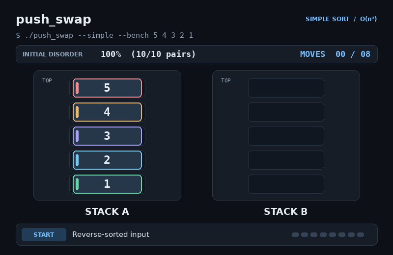
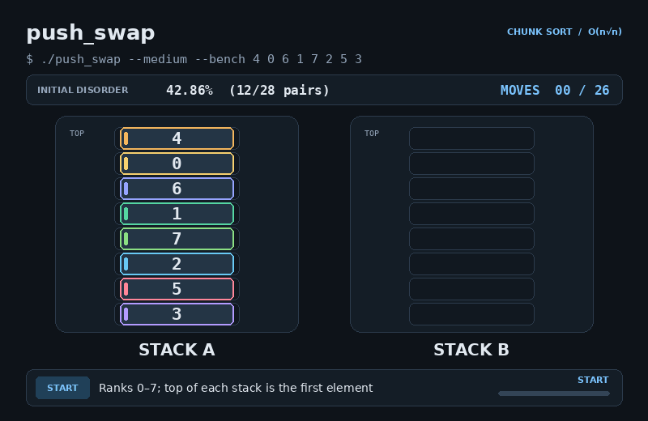
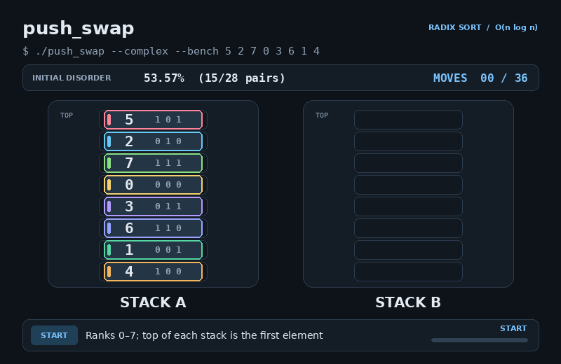

*This project has been created as part of the 42 curriculum by abozhek, gtakhiro.*

[English](README.md) | 日本語

# Push_swap

## 概要

Push_swap は、42 の基礎カリキュラム「42 Common Core」の C 言語プロジェクトです。
42 では実践的な課題に取り組み、受講生同士の評価で自分たちの実装を説明します。
カリキュラムについては、[リポジトリの概要](../README.ja.md)を参照してください。

この課題の目的は、2 つのスタックと限られた操作だけを使い、重複のない整数を
できるだけ少ない操作で並べ替えることです。スタックには先頭と末尾があります。
コマンドラインで最初に指定した整数がスタック A の先頭に入り、残りの整数は
指定順に続きます。スタック B は空の状態から始まり、値の一時置き場として使います。
操作が終わった時点で、A は先頭から昇順に並び、B は空になります。

このプロジェクトでは、2 つのコマンドラインプログラムをビルドできます。

| プログラム | 役割 |
| --- | --- |
| `push_swap` | 与えられた整数を並べ替える操作列を生成し、1 行に 1 命令ずつ出力します。 |
| `checker` | 操作列を同じ整数に適用し、正しく並べ替えられたかを判定するボーナスプログラムです。 |

たとえば、`2 1 3` を渡すと、`push_swap` は `sa` を出力します。
A の先頭 2 つを入れ替えると、`[2, 1, 3]` は 1 回の操作で `[1, 2, 3]` になります。

チームは 42 の課題評価で満点を取得しました。

## スタック操作

| 命令 | 動作 |
| --- | --- |
| `sa` | A の先頭 2 つの値を入れ替えます。 |
| `sb` | B の先頭 2 つの値を入れ替えます。 |
| `ss` | `sa` と `sb` を同時に行います。 |
| `pa` | B の先頭の値を A の先頭に移します。 |
| `pb` | A の先頭の値を B の先頭に移します。 |
| `ra` | A の先頭の値を末尾に移します。 |
| `rb` | B の先頭の値を末尾に移します。 |
| `rr` | `ra` と `rb` を同時に行います。 |
| `rra` | A の末尾の値を先頭に移します。 |
| `rrb` | B の末尾の値を先頭に移します。 |
| `rrr` | `rra` と `rrb` を同時に行います。 |

組み合わせた命令も含め、各命令は 1 回の操作として数えます。要素が 2 つ未満の
スタックに入れ替えや回転を適用しても状態は変わりません。空のスタックから値を
移す命令も同様です。組み合わせた命令では、各スタックに対して個別に処理します。

## アルゴリズムとデータ構造

### 順位への変換と乱れ度の計算

入力を検証した後、各値より小さい値の個数を、その値の順位とします。
たとえば、`40 -10 7` は `2 0 1` になります。値の大小関係を保ったまま、
`n` 個の整数を `0` から `n - 1` の順位に置き換えられます。

次に、大きい値が小さい値より先に現れる組を数えます。`3 1 2` では、
`(3, 1)` と `(3, 2)` が逆順です。全 3 組のうち 2 組が逆順なので、
乱れ度は `66.67%` です。昇順なら 0%、重複のない 2 個以上の整数が
降順なら 100% です。整数が 2 個未満の場合は 0% とします。

### ソート戦略

| フラグ | 方法 | 操作数の上限 |
| --- | --- | --- |
| `--simple` | A に残っている最小値を 1 つずつ取り出します。 | O(n²) |
| `--medium` | 連続した順位をグループごとに B へ移し、順番に A に戻します。 | O(n√n) |
| `--complex` | 順位を 2 進数で表し、ビットごとに並べ替えます。 | O(n log n) |
| `--adaptive` | 入力の乱れ度に応じ、上の 3 つから方法を選びます。 | 選択した方法による |

各戦略の動きは、下の **▶ アニメーション** をクリックすると確認できます。

- **Simple**。A の最小値を探し、操作回数が少ない方向に回転させて先頭へ移し、
  B に送ります。A に 4 個以上の値があり、まだ昇順でない間は、この処理を繰り返します。
  必要なら A に残った値を整列し、B の値を順に A に戻すと最小値が先頭に来ます。
  取り出しは最大 n 回で、1 回あたりの回転数は O(n) なので、全体の操作数は O(n²) です。

  <details>
  <summary><strong>▶ アニメーションを見る：シンプルなソート</strong></summary>

  

  </details>
  </br>

- **Medium**。順位を幅がおよそ √n のグループに分け、順位の低いグループから処理します。
  対象グループの値が先頭に来るまで A を回転させ、見つけた値を B に移します。
  各グループのうち順位が低い側の半分は、B を回転させて末尾へ送ります。
  A に戻すときは、B の最大値を先頭に移して A に送る操作を繰り返します。
  グループの幅を k とすると、A から各グループを取り出すには残りの A を最大 1 周すればよく、
  全体で O(n²/k) 回の操作になります。B では各グループが先に移したグループを
  挟む 2 つのまとまりになります。各グループを戻すための操作は、まとまりの中で O(k²) 回、
  間にあるグループをまたぐために最大 O(n) 回です。全グループでは O(nk + n²/k) 回となり、
  k をおよそ √n とすると O(n√n) 回になります。

  <details>
  <summary><strong>▶ アニメーションを見る：グループ単位のソート</strong></summary>

  

  </details>
  </br>

- **Complex**。2 進基数ソートを使い、順位の一番右のビットから処理します。
  各ビットについて、0 の値は B へ移し、1 の値は A の回転で末尾へ送ります。
  その後、B の値をすべて A に戻します。各パスで 0 同士、1 同士の相対的な順序が
  保たれるため、右から左へ処理すると順位が整列します。未整列の入力に対するパス数は
  最大 ⌈log₂(n)⌉ 回で、各パスの操作数は最大 2n 回です。

  <details>
  <summary><strong>▶ アニメーションを見る：2 進基数ソート</strong></summary>

  

  </details>
  </br>

- **Adaptive**。操作を始める前に乱れ度を 1 回計算します。20% 未満なら Simple、
  20% 以上 50% 未満なら Medium、50% 以上なら Complex を使います。
  これらのしきい値は課題文で定められています。乱れが小さい場合、Simple は A の残りが
  整列した時点で取り出しを打ち切れます。乱れが中程度なら、順位をグループごとに処理する
  ことで A を繰り返し一周する回数を抑えられます。乱れが大きい場合、基数ソートなら
  パス数の上限が明確です。戦略の選択には、表示用に丸める前の値を使います。

A がすでに昇順なら、どのモードでもソート処理を省略します。未整列の値が 5 個以下の場合は、
最小値を取り出す小規模入力用の処理を共通で使います。ベンチマークには、こうした場合も
選択した戦略と、その操作数の計算量が表示されます。

### 操作数・実行時間・メモリ使用量

上の表は、入力サイズが増えたときに出力される操作数の上限を示しています。
実際の処理では、重複の確認、順位への変換、乱れ度の計算にも時間がかかります。
これらの処理は値の組を比較するため、O(n²) の時間がかかります。
Simple と Medium は、次の最小値や最大値を探すためにもスタックを走査します。

各スタックには循環配列を使います。先頭の位置を添字で管理するため、回転するときは
配列全体をずらさず、先頭の位置を更新して 1 つの値を移せば済みます。
各命令をメモリ上で適用する処理は定数時間です。スタックと一時的な順位の配列は、
コマンドラインの入力文字数を L として O(L) の領域を使います。数値の表記と
数値ごとの空白の長さが一定の範囲に収まる通常の入力では O(n) です。
各戦略が配列以外に使う作業領域は一定で、命令は生成するたびに出力します。

### ソースファイル

| ファイル | 役割 |
| --- | --- |
| `main.c` | メインプログラムの開始点、戦略の選択、ソート処理の制御。 |
| `parse.c` | 引数の解析、フラグの処理、数値の検証。 |
| `rank.c` | 重複の確認、順位への変換、乱れ度の計算。 |
| `stack.c` | 循環配列を使ったスタックと命令の実行。 |
| `names.c` | ソートプログラムとチェッカーで共通の命令名。 |
| `sort.c` | 整列済みかの判定、小規模入力のソート、最小値の取り出し、基数ソート。 |
| `medium.c` | グループ単位のソート。 |
| `bench.c` | ベンチマーク結果の出力。 |
| `checker_bonus.c` | ボーナスプログラムの開始点、命令の読み込み、判定結果の出力。 |
| `utils.c` | 出力、比較、メモリの解放、エラー処理。 |
| `push_swap.h` | 共通のデータ構造と関数宣言。 |
| `Makefile` | 両方のプログラムのビルドと生成ファイルの削除。 |

## 使用方法

### コンパイル

実行例は `push_swap` ディレクトリで試してください。Make、`cc` として利用できる
C コンパイラ、Linux や WSL などの Unix 系環境が必要です。実行例では Bash を使います。
Makefile は `-Wall -Wextra -Werror` を指定してコンパイルします。両方のプログラムは
このディレクトリのファイルだけでビルドでき、Libft の別途ビルドや外部ライブラリは不要です。

リポジトリのルートから次のコマンドで両方をビルドできます。

```sh
cd push_swap
make all bonus
```

| コマンド | 動作 |
| --- | --- |
| `make`、`make all`、`make push_swap` | メインプログラムの `push_swap` をビルドします。 |
| `make bonus`、`make checker` | ボーナスプログラムの `checker` をビルドします。 |
| `make all bonus` | 両方のプログラムをビルドします。 |
| `make clean` | 両方のプログラムのオブジェクトファイルを削除します。 |
| `make fclean` | オブジェクトファイルと両方の実行ファイルを削除します。 |
| `make re` | `fclean` を実行してから `push_swap` を再ビルドします。`checker` も再ビルドするには、その後で `make bonus` を実行します。 |

### `push_swap` の実行

```text
./push_swap [--simple | --medium | --complex | --adaptive] [--bench] [整数 ...]
```

整数は個別の引数として渡すことも、引用符で囲んで 1 つの引数にまとめることもできます。
両方の形式を混ぜても構いません。引用符の中では空白文字が数値の区切りになります。
指定できるのは `-2147483648` から `2147483647` までの重複しない 10 進整数です。
先頭に `+` や `-` を付ける場合、その直後に数字が必要です。`1` と `+01` のように
表記が異なっても、値が同じなら重複として扱います。

```sh
./push_swap 4 67 3 87 23
./push_swap "4 67 3 87 23"
./push_swap 4 "67 3" 87 23
./push_swap +7 -3 0
./push_swap -2147483648 2147483647
```

既定では、入力の並びに応じて処理方法を選ぶ適応モードを使います。戦略は 1 つだけ
指定でき、`--bench` は 1 回だけ追加できます。フラグは独立した引数として、
整数の前、間、後のいずれにも指定できます。戦略ごとの処理を試すには、未整列の整数を
6 個以上渡してください。5 個以下の場合は、すべてのモードで同じ処理を使います。

```sh
./push_swap --simple 4 67 3 87 23 12
./push_swap --medium "4 67 3 87 23 12"
./push_swap --complex 4 67 3 87 23 12
./push_swap --adaptive 4 67 3 87 23 12
./push_swap 4 67 --medium 3 87 23 12 --bench
```

操作列は標準出力（stdout）に出力されます。引数がない場合や、整数が 1 個だけの場合、
すでに昇順の場合は、操作を出力しません。有効なフラグだけを渡すと、空の入力として
扱います。そのフラグに `--bench` があれば、操作数 0 のレポートを出力します。

重複する値、空または空白文字だけの引数、不正な数値、範囲外の整数、未対応のフラグ、
フラグの重複や競合がある場合は、標準エラー出力（stderr）に `Error` を出力し、
終了ステータス `1` を返します。

```sh
./push_swap 1 +01
./push_swap ""
./push_swap "   "
./push_swap 12x
./push_swap 2147483648
./push_swap --simple --medium 2 1
```

### ベンチマーク

`--bench` を付けると、入力の乱れ度（disorder）を小数点以下 2 桁の百分率で表示します。
あわせて、指定した戦略と選択された処理の操作数の計算量、操作の総数、全 11 命令の
内訳が表示されます。この機能で計測するのは操作数です。

```sh
./push_swap --adaptive --bench 4 67 3 87 23 12
./push_swap --bench 1 2 3
```

操作列は標準出力、ベンチマーク結果は標準エラー出力に出ます。`wc -l` で操作数を
数えたり、リダイレクトでそれぞれを別のファイルに保存したりできます。

```sh
./push_swap 4 67 3 87 23 12 | wc -l
./push_swap --bench 4 67 3 87 23 12 > moves.txt 2> benchmark.txt
```

### ボーナス版 `checker` の実行

```text
./checker [整数 ...]
```

`checker` は `push_swap` と同じ数値の形式と検証ルールを使います。
並べ替え前の整数を元の順序で渡してください。引数には整数だけを指定し、操作列は
標準入力（stdin）から渡します。命令は 1 行に 1 つ記述し、最後の命令にも改行を
付けます。入力の終端（EOF）に達すると、判定結果が表示されます。

| 結果 | 意味 | 出力先 | 終了ステータス |
| --- | --- | --- | --- |
| `OK` | A が昇順に並び、B が空です。 | stdout | `0` |
| `KO` | 命令は有効ですが、A が未整列か、B に値が残っています。 | stdout | `0` |
| `Error` | 不正な整数や命令があるか、命令の読み込みに失敗しました。 | stderr | `1` |

スクリプトで `OK` と `KO` を区別するには、出力された文字列を確認します。
未対応の命令、空行、余分な空白、最後の改行の欠落はエラーになります。
引数を渡さずに実行した場合は、標準入力を読み込まず、何も表示せずに終了します。

#### `push_swap` の操作列をパイプで渡す

```sh
./push_swap 4 67 3 87 23 | ./checker 4 67 3 87 23
./push_swap --complex --bench "4 67 3 87 23 12" | ./checker "4 67 3 87 23 12"
```

どちらのコマンドも `OK` を出力します。パイプが渡すのは標準出力だけなので、
2 つ目のコマンドではベンチマーク結果も端末に表示されます。
Bash で繰り返し試す場合は、配列を使うと両プログラムに同じ引数を渡せます。

```bash
numbers=(4 67 3 87 23 12)
./push_swap --medium "${numbers[@]}" | ./checker "${numbers[@]}"
```

#### 操作列をファイルに保存して再生する

```sh
./push_swap --bench 4 67 3 87 23 > moves.txt 2> benchmark.txt
./checker 4 67 3 87 23 < moves.txt
```

操作ファイルを手書きする場合は、Unix 形式の改行（LF）を使ったプレーンテキストで保存してください。

#### 操作を手動で指定する

```sh
printf 'sa\n' | ./checker 2 1 3  # OK
printf 'pb\n' | ./checker 1 2    # KO (B に値が残る)
printf 'xyz\n' | ./checker 2 1   # Error (未対応の命令)
printf 'sa' | ./checker 2 1      # Error (最後の改行がない)
./checker 1 2 3 < /dev/null      # OK (整列済み)
./checker 2 1 3 < /dev/null      # KO (未整列)
```

端末で `./checker 2 1 3` を実行し、`sa` と入力して Enter を押す方法もあります。
次の空行で Ctrl+D を押して EOF を送ると、`OK` が表示されます。

### 課題付属の Linux 版チェッカーで確認する

[`checker_linux`](./checker_linux) は、42 の課題に付属する x86-64 Linux 向けの
ビルド済み実行ファイルです。チームではボーナス版 `checker` の実装前に
`push_swap` の検証に使い、実装後には両方のチェッカーの判定を比較しました。

対応する Linux 環境で `push_swap` をビルドし、操作列をパイプで渡します。
チェッカーにも同じ整数を同じ順序で指定します。

```sh
make
./push_swap 4 67 3 87 23 | ./checker_linux 4 67 3 87 23
```

この例では `OK` が表示されます。付属ファイルに実行権限がない場合は、
実行する前に `chmod +x checker_linux` を実行してください。

2 つのチェッカーを比較するには、操作列を一度生成し、両方に同じファイルと
同じ初期値を渡します。

```sh
make all bonus
./push_swap 4 67 3 87 23 > moves.txt
./checker_linux 4 67 3 87 23 < moves.txt
./checker 4 67 3 87 23 < moves.txt
```

この入力では、両方とも `OK` を出力します。

### `shuf` でテスト入力を生成する

Linux の GNU Coreutils には `shuf` が含まれています。`-i` で両端を含む範囲を
指定し、`-n` でその範囲から重複なしで選ぶ個数を指定します。
この例では 1 行につき 1 個の整数をファイルに保存します。

```sh
shuf -i 1-10000 -n 200 > numbers-200.txt
wc -l numbers-200.txt
```

`wc -l` はファイルの行数を表示します。

```text
200 numbers-200.txt
```

Bash の `mapfile -t` は、ファイルから 1 行ずつ読み込み、改行を除いて配列に格納します。
`"${numbers[@]}"` と展開すると、各整数が個別の引数として渡され、両方のチェッカーで
使えます。同じ配列を使うことで、各プログラムに同じ値を同じ順序で渡せます。

```bash
make all bonus
mapfile -t numbers < numbers-200.txt
./push_swap --bench "${numbers[@]}" > moves-200.txt
./checker "${numbers[@]}" < moves-200.txt
./checker_linux "${numbers[@]}" < moves-200.txt
wc -l < moves-200.txt
```

200 個の整数で実行したときの出力例です。

```text
[bench] disorder: 48.70%
[bench] strategy: Adaptive / O(n√n)
[bench] total_ops: 2036
[bench] sa: 0  sb: 0  ss: 0  pa: 200  pb: 200
[bench] ra: 1191  rb: 229  rr: 0  rra: 0  rrb: 216  rrr: 0
OK
OK
2036
```

ベンチマーク結果は標準エラー出力に送られるため、端末に表示されます。
乱れ度が 48.70% だったので、適応モードは中程度の乱れに対応するアルゴリズムを
選びました。最初の `OK` はボーナス版 `checker`、次の `OK` は
`checker_linux` の判定です。最後の `2036` は `moves-200.txt` の行数で、
`total_ops` と一致します。別の乱数列では、乱れ度、選択されるアルゴリズム、
操作数が変わることがあります。

入力ファイルを残しておけば、まったく同じテストを再実行できます。
`shuf` を再実行すると別の入力が生成され、`>` で同じファイル名を指定すると
上書きされます。

### 課題評価のベンチマーク

42 の課題文の VI.6 節では、ランダムな入力に対する操作数の基準が定められています。
各基準を満たすには、操作数が表の値を下回る必要があります。

| 入力サイズ | 合格 | 良好 | 優秀 |
| ---: | ---: | ---: | ---: |
| 100 個 | < 2,000 | < 1,500 | < 700 |
| 500 個 | < 12,000 | < 8,000 | < 5,500 |

両方のプログラムをビルドしたら、評価で使われる 2 つの入力サイズで同じテストを
実行できます。ベンチマーク結果は端末に表示され、操作列は再生用にファイルへ保存されます。

```bash
for size in 100 500; do
    shuf -i 1-10000 -n "$size" > "numbers-$size.txt"
    mapfile -t numbers < "numbers-$size.txt"
    ./push_swap --bench "${numbers[@]}" > "moves-$size.txt"
    ./checker "${numbers[@]}" < "moves-$size.txt"
    ./checker_linux "${numbers[@]}" < "moves-$size.txt"
done
```

**100 個の整数**

```text
[bench] disorder: 49.82%
[bench] strategy: Adaptive / O(n√n)
[bench] total_ops: 801
[bench] sa: 0  sb: 0  ss: 0  pa: 100  pb: 100
[bench] ra: 433  rb: 89  rr: 0  rra: 0  rrb: 79  rrr: 0
OK
OK
```

**乱れ度が 50% を超える 500 個の整数**

適応モードが 2 進基数ソートに切り替わる例として、ランダムな入力を複数回生成し、
その中からこの入力を選びました。

```text
[bench] disorder: 50.66%
[bench] strategy: Adaptive / O(n log n)
[bench] total_ops: 6784
[bench] sa: 0  sb: 0  ss: 0  pa: 2284  pb: 2284
[bench] ra: 2216  rb: 0  rr: 0  rra: 0  rrb: 0  rrr: 0
OK
OK
```

どちらの実行例も「良好」の基準を満たしています。操作数は生成した入力によって変わります。

## 参考資料

- **42 Push_swap の課題文（v1.2）** — 操作のルール、戦略の要件、評価基準。[PDF](../subjects/push_swap.pdf)
- **Thomas H. Cormen ほか『Introduction to Algorithms』** — 転倒数、ソート手法、計算量の表し方。
- **Donald E. Knuth『The Art of Computer Programming』第 3 巻** — ソート手法。
- **Unix のマニュアルページ** — `man 1 make`、`man 2 read`、`man 2 write`、
  `man 3 malloc`、`man 3 free`。
- **Norminette** — インストール済みの場合は、このディレクトリで `norminette *.c *.h` を
  実行すると、C ソースファイルとヘッダーが 42 のコーディング規約に沿っているか確認できます。

### AI の利用

学習とコードレビューに AI を使用しました。
